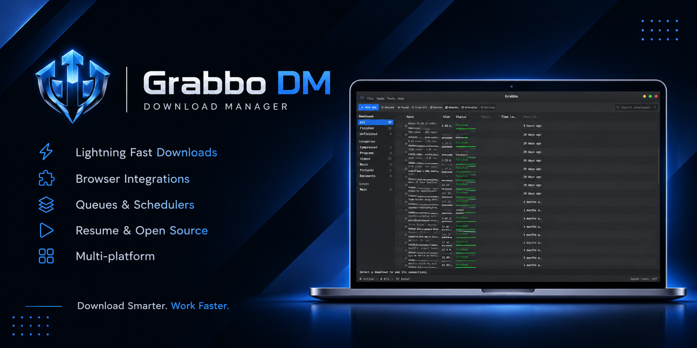
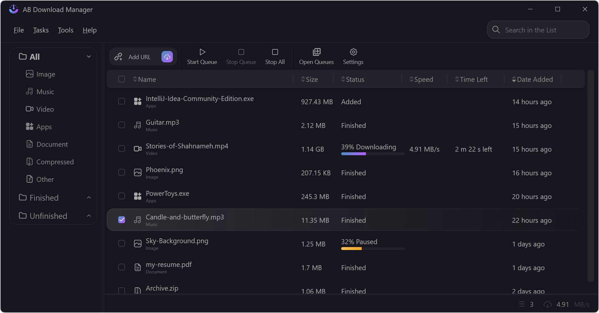

<div align="center">

  <!-- ==================== LOGO PLACEHOLDER ==================== -->
  <!-- Replace assets/logo/grabbo_logo.png with your final logo image -->
  
  
  <h1>Grabbo</h1>
  <p><strong>A modern, powerful download manager with seamless 4K video grabbing & automated browser integration.</strong></p>

  <p>
    
    
    
  </p>

</div>

---

<!-- ==================== HERO BANNER PLACEHOLDER ==================== -->
<!-- Place your full app banner image here -->
<div align="center">
  
  <!-- <em>[Hero Banner Image Placeholder - Recommended resolution: 1280x640]</em> -->
</div>

---

## ⚡ What is Grabbo?

**Grabbo** is a next-generation download manager built with Kotlin Multiplatform and Jetpack Compose. It blends the raw multithreaded download speed of classic download managers with an embedded high-resolution media grabbing engine (powered by `yt-dlp`), letting you grab 1080p, 2K, 4K, 60fps streams and regular files with zero hassle.

---

## ✨ Features

- 🚀 **Accelerated Multi-Connection Downloads:** Splits files into dynamic multi-threaded chunks for maximum bandwidth saturation.
- 🎬 **Advanced Video & Audio Grabber:** Built-in resolution selector supporting 1080p, 1440p, 4K, 60fps video, and standalone audio tracks.
- 🍪 **Automatic Browser Cookie Bridge:** Syncs live session cookies from your browser extension to effortlessly bypass YouTube bot verification ("Sign in to confirm you're not a bot").
- 🌐 **Browser Extensions:** Real-time download capturing for Google Chrome, Mozilla Firefox, Brave, Microsoft Edge, and Opera.
- ⏰ **Smart Queues & Schedulers:** Organize downloads into queues, set start/stop timers, and configure per-host connection limits.
- 🎨 **Modern & Adaptive UI:** Fluid animations, customizable dark, light, and OLED black themes with fully responsive controls.
- 💻 **True Multiplatform:** First-class desktop experience on Windows, Linux, and macOS, alongside Android support.

---

## 📸 Screenshots

<div align="center">

  ### Main Download Manager
  <!-- ==================== SCREENSHOT PLACEHOLDER 1 ==================== -->
  
  <p><em>[Screenshot: Grabbo Main Dashboard - Dark Theme]</em></p>

  <br/>

  ### 4K Video Quality Selector
  <!-- ==================== SCREENSHOT PLACEHOLDER 2 ==================== -->
  
  <p><em>[Screenshot: 4K / 1080p / 60fps Media Resolution Dropdown]</em></p>

  <br/>

  ### Add Download Dialog
  <!-- ==================== SCREENSHOT PLACEHOLDER 3 ==================== -->
  
  <p><em>[Screenshot: Add Download Dialog with Pinned Action Controls]</em></p>

</div>

---

## 📥 Installation

> **Note:** Binary releases and direct installers will be made available here once the initial release builds are published.

### Desktop (Windows / Linux / macOS)
- **Windows:** Standalone `.exe` installer (with automatic browser host registration).
- **Linux:** Native binary bundle and `.desktop` integration script.
- **macOS:** `.dmg` application image.

### Browser Extension
The companion browser extension catches downloads from your browser and enables 4K YouTube stream extraction.
- **Chrome / Brave / Edge:** Available via unpacked extension or Web Store package.
- **Firefox:** Manifest V3 / V2 compatible add-on.

---

## 🛠️ Build From Source

### Prerequisites
- **JDK:** Java 21 or Java 25 (`JAVA_HOME` pointing to your JDK).
- **Git**

### 1. Build the Desktop Application
```bash
# Clone the repository
git clone https://github.com/allenmiky/grabloo.git
cd grabloo

# Compile the desktop application
./gradlew :desktop:app:compileKotlin

# Run the app locally
./gradlew :desktop:app:run
```

### 2. Build the Browser Extension
```bash
cd ab-download-manager-browser-integration

# Install dependencies
npm install

# Build extension for Chrome & Firefox
npm run build
```
Packaged extension outputs will be in `ab-download-manager-browser-integration/dist/`.

---

## 📜 Credits & License

- Based on the open-source architecture originally created by [amir1376](https://github.com/amir1376).
- Enhanced with native YouTube media extraction and continuous browser integration by the **Grabbo** team.
- Licensed under the **Apache License, Version 2.0**. See the [LICENSE](LICENSE) file for complete details.

